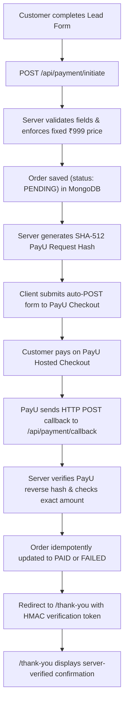

# Grow Spark – Business Growth Audit (Next.js)

Next.js (App Router, TypeScript strict) conversion of the static landing page in `assets/` with a PayU India payment integration and MongoDB order persistence.

Target domain: <https://growthaudit.growsparkconsulting.com>

`assets/` holds the original HTML/VCF/logo as **read-only reference copies**. The app does not use them.

---

## Run locally

```bash
npm install
npm run dev          # http://localhost:3000
npm run test         # Run PayU hash and verification test suite
npm run lint         # ESLint checks
npm run typecheck    # TypeScript compiler check
npm run build        # Production Next.js build
npm start
```

---

## Payment & Order Architecture (PayU India Hosted Checkout)

The application provides a fully server-verified payment workflow:



### Security Highlights
- **Server-enforced price**: Payment amount is strictly set to ₹999.00 on the server; client-supplied amounts are never accepted.
- **Reverse Hash Verification**: PayU callback reverse hash is calculated using SHA-512 and verified via `crypto.timingSafeEqual` to prevent tampering and timing attacks. Both standard responses and `additionalCharges` variants are supported.
- **Idempotency**: Duplicate callbacks from PayU do not overwrite already-settled `PAID` orders.
- **Verification Token**: Thank-you page and `/api/orders/[txnid]/status` require an HMAC-SHA256 signature (`txnid:status:amount`), preventing transaction enumeration and unverified confirmation visits.
- **Credential Safety**: Private keys, PayU salt, and MongoDB connection strings are server-only and excluded from client bundles.

---

## Environment Variables

Copy `.env.example` to `.env.local` for local development:

```bash
cp .env.example .env.local
```

| Variable | Description | Example / Default |
|---|---|---|
| `NEXT_PUBLIC_SITE_URL` | Canonical site URL (and base URL for PayU callbacks) | `https://growthaudit.growsparkconsulting.com` |
| `MONGODB_URI` | MongoDB Atlas connection string (Server only) | `mongodb+srv://<user>:<password>@cluster.mongodb.net/growth_audit?retryWrites=true&w=majority` |
| `MONGODB_DB_NAME` | Database name | `growth_audit` |
| `PAYU_TEST_MERCHANT_KEY` | PayU test merchant key (server only) | PayU test account |
| `PAYU_TEST_MERCHANT_SALT` | PayU test merchant salt (server only) | PayU test account |
| `PAYU_PRODUCTION_MERCHANT_KEY` | PayU production merchant key (server only; required for production mode) | PayU production account |
| `PAYU_PRODUCTION_MERCHANT_SALT` | PayU production merchant salt (server only; required for production mode) | PayU production account |
| `PAYU_MODE` | Required gateway mode (`test` or `production`); invalid or missing values disable checkout | `test` |
| `ORDER_VERIFICATION_SECRET` | Optional server-only HMAC key (defaults to the selected mode's PayU salt) | Safe random string |

Legacy `PAYU_MERCHANT_KEY` and `PAYU_MERCHANT_SALT` variables remain supported for test mode only. Production mode never falls back to them. The production site URL must be configured as a public HTTPS origin; localhost and tunnel URLs are rejected in production mode.

---

## MongoDB Atlas Setup & Indexes

1. Create a cluster on [MongoDB Atlas](https://www.mongodb.com/cloud/atlas).
2. Under **Network Access**, allow access from your deployment IP / Vercel (or `0.0.0.0/0` with secure credentials).
3. Under **Database Access**, create a user with read/write permissions.
4. Add the connection URI to `MONGODB_URI` in `.env.local` or host dashboard.
5. **Indexes**: The app automatically calls `ensureOrderIndexes()` on order creation. You can also manually create the unique index in mongosh or Atlas UI:
   ```javascript
   use growth_audit;
   db.orders.createIndex({ txnid: 1 }, { unique: true, name: "uniq_txnid" });
   db.orders.createIndex({ createdAt: -1 }, { name: "idx_created_at" });
   db.orders.createIndex({ status: 1 }, { name: "idx_status" });
   ```

---

## Testing PayU Sandbox Locally

Because PayU Hosted Checkout redirects back via server-to-server HTTP POST callbacks to `surl`/`furl`, your local server must be accessible to PayU:

1. Start your local dev server:
   ```bash
   npm run dev
   ```
2. Expose port 3000 using a public tunnel (e.g. `cloudflared` or `ngrok`):
   ```bash
   ngrok http 3000
   ```
3. Set `NEXT_PUBLIC_SITE_URL` in `.env.local` to your tunnel URL (e.g., `https://abc123.ngrok-free.app`).
4. Ensure `PAYU_MODE=test` and set `PAYU_TEST_MERCHANT_KEY` and `PAYU_TEST_MERCHANT_SALT` for your PayU test account. Existing local setups may continue using the legacy generic variables in test mode.
5. Fill the form at `http://localhost:3000` and submit to test the complete sandbox payment and callback cycle.

---

## Structure

- `src/app/(landing)/` – `/` (own root layout + `landing.css`, original CSS verbatim)
- `src/app/(thank-you)/thank-you/` – `/thank-you` (own root layout + `thank-you.css`, verifies order token)
- `src/app/api/payment/initiate/` – Route handler: validates form, saves PENDING order, generates PayU request hash
- `src/app/api/payment/callback/` – Route handler: receives PayU POST callback, verifies reverse hash, updates order status, redirects to thank-you page
- `src/app/api/orders/[txnid]/status/` – Secure order status endpoint gated by HMAC token
- `src/lib/db.ts` – MongoDB connection pool singleton
- `src/lib/orders.ts` – Order document model, index management, and idempotent status transitions
- `src/lib/payu.ts` – PayU request/reverse SHA-512 hashing, constant-time verification, and HMAC tokens
- `tests/payu.test.ts` – Unit test suite covering hash calculation, tampering detection, and validation

---

## Deploy to Vercel

1. Push the repo to GitHub and import it into Vercel.
2. In **Project → Settings → Environment Variables**, configure:
   - `NEXT_PUBLIC_SITE_URL` = `https://growthaudit.growsparkconsulting.com`
   - `MONGODB_URI` = your production MongoDB Atlas connection string
   - `MONGODB_DB_NAME` = `growth_audit`
   - `PAYU_PRODUCTION_MERCHANT_KEY` = production merchant key from the PayU production account
   - `PAYU_PRODUCTION_MERCHANT_SALT` = production merchant salt from the PayU production account
   - `PAYU_MODE` = `production`
3. Add custom domain `growthaudit.growsparkconsulting.com` and point DNS CNAME to Vercel. Set `NEXT_PUBLIC_SITE_URL` to that public HTTPS origin; production callbacks reject localhost and tunnel hosts.
4. Review the production configuration and callback URL before enabling production checkout. Do not use sandbox credentials or endpoints for live transactions.
