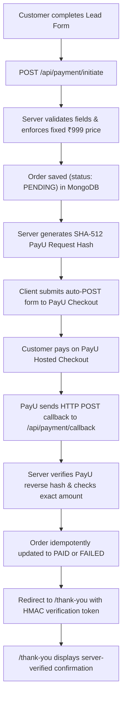

# Grow Spark – Business Growth Audit (Next.js)

Next.js (App Router, TypeScript strict) conversion of the static landing page in `assets/` with a PayU India payment integration and MongoDB order persistence.

Target domain: <https://growthaudit.growsparkconsulting.com>

`assets/` holds the original HTML/VCF/logo as **read-only reference copies**. The app does not use them.

---

## Run locally

```bash
npm install
npm run dev          # http://localhost:3000
npm run test         # Run PayU hash and verification test suite
npm run lint         # ESLint checks
npm run typecheck    # TypeScript compiler check
npm run build        # Production Next.js build
npm start
```

---

## Payment & Order Architecture (PayU India Hosted Checkout)

The application provides a fully server-verified payment workflow:



### Security Highlights
- **Server-enforced price**: Payment amount is strictly set to ₹999.00 on the server; client-supplied amounts are never accepted.
- **Reverse Hash Verification**: PayU callback reverse hash is calculated using SHA-512 and verified via `crypto.timingSafeEqual` to prevent tampering and timing attacks. Both standard responses and `additionalCharges` variants are supported.
- **Idempotency**: Duplicate callbacks from PayU do not overwrite already-settled `PAID` orders.
- **Verification Token**: Thank-you page and `/api/orders/[txnid]/status` require an HMAC-SHA256 signature (`txnid:status:amount`), preventing transaction enumeration and unverified confirmation visits.
- **Credential Safety**: Private keys, PayU salt, and MongoDB connection strings are server-only and excluded from client bundles.

---

## Environment Variables

Copy `.env.example` to `.env.local` for local development:

```bash
cp .env.example .env.local
```

| Variable | Description | Example / Default |
|---|---|---|
| `NEXT_PUBLIC_SITE_URL` | Canonical site URL (and base URL for PayU callbacks) | `https://growthaudit.growsparkconsulting.com` |
| `MONGODB_URI` | MongoDB Atlas connection string (Server only) | `mongodb+srv://<user>:<password>@cluster.mongodb.net/growth_audit?retryWrites=true&w=majority` |
| `MONGODB_DB_NAME` | Database name | `growth_audit` |
| `PAYU_TEST_MERCHANT_KEY` | PayU test merchant key (server only) | PayU test account |
| `PAYU_TEST_MERCHANT_SALT` | PayU test merchant salt (server only) | PayU test account |
| `PAYU_PRODUCTION_MERCHANT_KEY` | PayU production merchant key (server only; required for production mode) | PayU production account |
| `PAYU_PRODUCTION_MERCHANT_SALT` | PayU production merchant salt (server only; required for production mode) | PayU production account |
| `PAYU_MODE` | Required gateway mode (`test` or `production`); invalid or missing values disable checkout | `test` |
| `ORDER_VERIFICATION_SECRET` | Optional server-only HMAC key (defaults to the selected mode's PayU salt) | Safe random string |

| `ZOHO_CLIENT_ID` | Zoho API Console Self Client ID (server only) | — |
| `ZOHO_CLIENT_SECRET` | Self Client secret (server only) | — |
| `ZOHO_REFRESH_TOKEN` | Refresh token with the scopes listed under [Zoho CRM integration](#zoho-crm-integration) (server only) | — |
| `ZOHO_ACCOUNTS_URL` | Accounts server of your Zoho data center | `https://accounts.zoho.in` |
| `ZOHO_API_VERSION` | Optional Zoho CRM REST API version | `v8` |
| `CRON_SECRET` | Bearer secret for `/api/internal/zoho-sync-retry` (Vercel Cron sends it automatically) | Long random string |

Legacy `PAYU_MERCHANT_KEY` and `PAYU_MERCHANT_SALT` variables remain supported for test mode only. Production mode never falls back to them. The production site URL must be configured as a public HTTPS origin; localhost and tunnel URLs are rejected in production mode.

---

## Zoho CRM Integration

Every lead-form submission becomes one Zoho CRM Lead, whether or not the customer pays.

1. `/api/payment/initiate` validates the form and saves the order (`status: PENDING`, `zoho.status: PENDING`) **before** PayU checkout starts.
2. After the response is sent (`after()`), the Lead is created with `Lead_Source = "Growth Audit Free"` and its ID is stored on the order (`zoho.leadId`).
3. When the hash-verified PayU callback marks the order `PAID`, the same Lead (by stored ID) is updated to `Lead_Source = "Growth Audit Paid"` and a payment note (amount, submission reference, PayU ID) is attached. Failed or abandoned payments keep `Growth Audit Free`; payment status stays on the order (`PENDING` / `FAILED` / `PAID`).
4. Zoho failures never block checkout or the thank-you redirect. The order is marked `RETRY_REQUIRED` with exponential backoff (1 min doubling to 6 h, 10 attempts) and retried by `/api/internal/zoho-sync-retry`.

| Form field | Zoho Lead field |
|---|---|
| Your name | `First_Name` (all but the last word) + `Last_Name` (last word; whole name if one word). Names over the field limits are also written in full to `Description`. |
| Phone | `Mobile` (spaces, dashes and brackets removed) |
| Email | `Email` |
| Company name | `Company` |
| Company website | `Website` (omitted when blank) |
| Team size, Industry, Annual revenue, Business challenge | `Description`: `Team Size: 16-30 \| Industry: Manufacturing with the annual revenue of ₹1-2 crore. Challenge mentioned: Stuck at the same revenue for years` (no custom fields, which the Zoho Free edition does not support) |

**Duplicate prevention.** Zoho's search index trails new records by roughly a minute (measured at 40–90 seconds), so a missing search result does not prove no Lead exists. Leads are matched in this order:
1. the order's own stored `zoho.leadId`;
2. the Lead ID of an earlier submission with the same email in MongoDB, read from Zoho by ID;
3. a Zoho search by email, for older Leads from other channels;
4. otherwise `Leads/upsert` keyed on Email. Zoho's duplicate check is immediate, so a Lead created seconds earlier is updated instead of duplicated.

A per-order database lease stops checkout, callbacks and the retry job from syncing the same order concurrently. Repeated PayU callbacks find the order already synced and do nothing.

**Existing Leads with the same email.** Existing values are never overwritten: only empty fields are filled, the full new submission is attached as a Note (with the previous Lead Source), and `Lead_Source` is set to the Growth Audit value. A Lead that already shows `Growth Audit Paid` is never downgraded to `Growth Audit Free`.

**Lead Source safety.** Before writing, the server reads the `Lead_Source` picklist (cached for 10 minutes). If a required value is missing, the sync is not sent and the error `LEAD_SOURCE_NOT_IN_PICKLIST` is logged and stored on the order.

### Zoho setup

1. In Zoho CRM, go to **Setup → Customization → Modules and Fields → Leads → Lead Source**. Add the picklist values `Growth Audit Free` and `Growth Audit Paid` (exact spelling).
2. Open the API Console for your data center (for India: <https://api-console.zoho.in>), then **Add Client → Self Client → Create**. Copy the Client ID and Client Secret.
3. In the Self Client's **Generate Code** tab, enter the scope `ZohoCRM.modules.leads.ALL,ZohoCRM.modules.notes.CREATE,ZohoCRM.settings.fields.READ`. Pick a 10-minute duration, choose your CRM organization, and copy the grant code.
4. Within those 10 minutes, exchange the code for a refresh token:
   ```bash
   curl -X POST "https://accounts.zoho.in/oauth/v2/token" \
     -d "grant_type=authorization_code" \
     -d "client_id=YOUR_CLIENT_ID" \
     -d "client_secret=YOUR_CLIENT_SECRET" \
     -d "code=YOUR_GRANT_CODE"
   ```
   Store `refresh_token` from the response. The `api_domain` it returns confirms your data center. Leads created by the integration are owned by the Zoho user who generated the code.
5. Set `ZOHO_CLIENT_ID`, `ZOHO_CLIENT_SECRET`, `ZOHO_REFRESH_TOKEN` and `ZOHO_ACCOUNTS_URL` in `.env.local`, then run the read-only check:
   ```bash
   npm run zoho:verify
   ```
   It confirms authentication, the Leads field API names and types, and both `Lead_Source` values. It never creates or edits records.

### Environments

- **Local / staging:** leave the `ZOHO_*` credentials empty (submissions queue as `PENDING` and nothing reaches the CRM). Alternatively, use a separate Zoho test org with its own Self Client. Pointing staging at the production CRM creates real Leads.
- **Production:** set the variables in **Vercel → Project → Settings → Environment Variables**, including a random `CRON_SECRET`.

### Retry job and operations

`vercel.json` schedules `/api/internal/zoho-sync-retry` daily at 03:30 UTC, which is the most frequent schedule the Vercel Hobby plan allows. On Pro, increase the frequency (for example `*/15 * * * *`), or call the endpoint from any external scheduler:

```bash
curl -X POST -H "Authorization: Bearer $CRON_SECRET" https://growthaudit.growsparkconsulting.com/api/internal/zoho-sync-retry
```

The job processes up to 10 due orders per run: stale `PENDING`, due `RETRY_REQUIRED`, and `PAID` orders whose Lead is not yet `Growth Audit Paid`. `FAILED` orders (Zoho validation errors such as `INVALID_DATA:Email`, `LEAD_NOT_FOUND` for converted or deleted Leads, or 10 failed attempts) need review. Inspect and requeue them in mongosh:

```javascript
db.orders.find({ "zoho.status": "FAILED" }, { txnid: 1, "zoho.lastError": 1 });
db.orders.updateMany(
  { "zoho.status": "FAILED" },
  { $set: { "zoho.status": "RETRY_REQUIRED", "zoho.attempts": 0 }, $unset: { "zoho.nextRetryAt": "" } }
);
// Opt in orders created before the integration existed:
db.orders.updateMany({ zoho: { $exists: false } }, { $set: { zoho: { status: "PENDING", attempts: 0 } } });
// Abandoned checkouts (no payment after 24 hours):
db.orders.find({ status: "PENDING", createdAt: { $lt: new Date(Date.now() - 864e5) } });
```

---

## MongoDB Atlas Setup & Indexes

1. Create a cluster on [MongoDB Atlas](https://www.mongodb.com/cloud/atlas).
2. Under **Network Access**, allow access from your deployment IP / Vercel (or `0.0.0.0/0` with secure credentials).
3. Under **Database Access**, create a user with read/write permissions.
4. Add the connection URI to `MONGODB_URI` in `.env.local` or host dashboard.
5. **Indexes**: The app automatically calls `ensureOrderIndexes()` on order creation. You can also manually create the unique index in mongosh or Atlas UI:
   ```javascript
   use growth_audit;
   db.orders.createIndex({ txnid: 1 }, { unique: true, name: "uniq_txnid" });
   db.orders.createIndex({ createdAt: -1 }, { name: "idx_created_at" });
   db.orders.createIndex({ status: 1 }, { name: "idx_status" });
   ```

---

## Testing PayU Sandbox Locally

Because PayU Hosted Checkout redirects back via server-to-server HTTP POST callbacks to `surl`/`furl`, your local server must be accessible to PayU:

1. Start your local dev server:
   ```bash
   npm run dev
   ```
2. Expose port 3000 using a public tunnel (e.g. `cloudflared` or `ngrok`):
   ```bash
   ngrok http 3000
   ```
3. Set `NEXT_PUBLIC_SITE_URL` in `.env.local` to your tunnel URL (e.g., `https://abc123.ngrok-free.app`).
4. Ensure `PAYU_MODE=test` and set `PAYU_TEST_MERCHANT_KEY` and `PAYU_TEST_MERCHANT_SALT` for your PayU test account. Existing local setups may continue using the legacy generic variables in test mode.
5. Fill the form at `http://localhost:3000` and submit to test the complete sandbox payment and callback cycle.

---

## Structure

- `src/app/(landing)/` – `/` (own root layout + `landing.css`, original CSS verbatim)
- `src/app/(thank-you)/thank-you/` – `/thank-you` (own root layout + `thank-you.css`, verifies order token)
- `src/app/api/payment/initiate/` – Route handler: validates form, saves PENDING order, generates PayU request hash
- `src/app/api/payment/callback/` – Route handler: receives PayU POST callback, verifies reverse hash, updates order status, redirects to thank-you page
- `src/app/api/orders/[txnid]/status/` – Secure order status endpoint gated by HMAC token
- `src/app/api/internal/zoho-sync-retry/` – `CRON_SECRET`-protected job that retries pending CRM syncs
- `src/lib/db.ts` – MongoDB connection pool singleton
- `src/lib/orders.ts` – Order document model, index management, idempotent status transitions, and CRM sync state
- `src/lib/payu.ts` – PayU request/reverse SHA-512 hashing, constant-time verification, and HMAC tokens
- `src/lib/zoho.ts` – Zoho OAuth token management, Lead field mapping, and Lead create/update/note API calls
- `src/lib/zoho-sync.ts` – Free/Paid Lead synchronization, leasing, retry and backoff
- `scripts/zoho-verify.ts` – Read-only Zoho configuration check (`npm run zoho:verify`)
- `tests/payu.test.ts` – Unit test suite covering hash calculation, tampering detection, and validation
- `tests/zoho*.test.ts` – Zoho mapping, OAuth, duplicate prevention and payment-scenario tests against a mocked Zoho API

---

## Deploy to Vercel

1. Push the repo to GitHub and import it into Vercel.
2. In **Project → Settings → Environment Variables**, configure:
   - `NEXT_PUBLIC_SITE_URL` = `https://growthaudit.growsparkconsulting.com`
   - `MONGODB_URI` = your production MongoDB Atlas connection string
   - `MONGODB_DB_NAME` = `growth_audit`
   - `PAYU_PRODUCTION_MERCHANT_KEY` = production merchant key from the PayU production account
   - `PAYU_PRODUCTION_MERCHANT_SALT` = production merchant salt from the PayU production account
   - `PAYU_MODE` = `production`
   - `ZOHO_CLIENT_ID`, `ZOHO_CLIENT_SECRET`, `ZOHO_REFRESH_TOKEN`, `ZOHO_ACCOUNTS_URL` and `CRON_SECRET` (see [Zoho CRM integration](#zoho-crm-integration))
3. Add custom domain `growthaudit.growsparkconsulting.com` and point DNS CNAME to Vercel. Set `NEXT_PUBLIC_SITE_URL` to that public HTTPS origin; production callbacks reject localhost and tunnel hosts.
4. Review the production configuration and callback URL before enabling production checkout. Do not use sandbox credentials or endpoints for live transactions.
