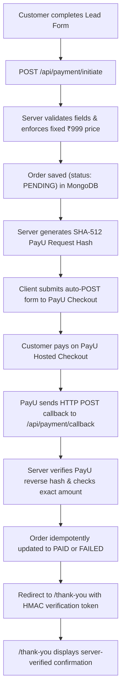

# Grow Spark – Business Growth Audit (Next.js)

Next.js (App Router, TypeScript strict) conversion of the static landing page in `assets/` with a PayU India payment integration and MongoDB order persistence.

Target domain: <https://growthaudit.growsparkconsulting.com>

`assets/` holds the original HTML/VCF/logo as **read-only reference copies**. The app does not use them.

---

## Run locally

```bash
npm install
npm run dev          # http://localhost:3000
npm run test         # Run PayU hash and verification test suite
npm run lint         # ESLint checks
npm run typecheck    # TypeScript compiler check
npm run build        # Production Next.js build
npm start
```

---

## Payment & Order Architecture (PayU India Hosted Checkout)

The application provides a fully server-verified payment workflow:



### Security Highlights
- **Server-enforced price**: Payment amount is strictly set to ₹999.00 on the server; client-supplied amounts are never accepted.
- **Reverse Hash Verification**: PayU callback reverse hash is calculated using SHA-512 and verified via `crypto.timingSafeEqual` to prevent tampering and timing attacks. Both standard responses and `additionalCharges` variants are supported.
- **Idempotency**: Duplicate callbacks from PayU do not overwrite already-settled `PAID` orders.
- **Verification Token**: Thank-you page and `/api/orders/[txnid]/status` require an HMAC-SHA256 signature (`txnid:status:amount`), preventing transaction enumeration and unverified confirmation visits.
- **Credential Safety**: Private keys, PayU salt, and MongoDB connection strings are server-only and excluded from client bundles.

---

## Environment Variables

Copy `.env.example` to `.env.local` for local development:

```bash
cp .env.example .env.local
```

| Variable | Description | Example / Default |
|---|---|---|
| `NEXT_PUBLIC_SITE_URL` | Canonical site URL (and base URL for PayU callbacks) | `https://growthaudit.growsparkconsulting.com` |
| `MONGODB_URI` | MongoDB Atlas connection string (Server only) | `mongodb+srv://<user>:<password>@cluster.mongodb.net/growth_audit?retryWrites=true&w=majority` |
| `MONGODB_DB_NAME` | Database name | `growth_audit` |
| `PAYU_TEST_MERCHANT_KEY` | PayU test merchant key (server only) | PayU test account |
| `PAYU_TEST_MERCHANT_SALT` | PayU test merchant salt (server only) | PayU test account |
| `PAYU_PRODUCTION_MERCHANT_KEY` | PayU production merchant key (server only; required for production mode) | PayU production account |
| `PAYU_PRODUCTION_MERCHANT_SALT` | PayU production merchant salt (server only; required for production mode) | PayU production account |
| `PAYU_MODE` | Required gateway mode (`test` or `production`); invalid or missing values disable checkout | `test` |
| `ORDER_VERIFICATION_SECRET` | Optional server-only HMAC key (defaults to the selected mode's PayU salt) | Safe random string |

| `ZOHO_CLIENT_ID` | Zoho API Console Self Client ID (server only) | — |
| `ZOHO_CLIENT_SECRET` | Self Client secret (server only) | — |
| `ZOHO_REFRESH_TOKEN` | Refresh token with the scopes listed under [Zoho CRM integration](#zoho-crm-integration) (server only) | — |
| `ZOHO_ACCOUNTS_URL` | Accounts server of your Zoho data center | `https://accounts.zoho.in` |
| `ZOHO_API_VERSION` | Optional Zoho CRM REST API version | `v8` |
| `CRON_SECRET` | Bearer secret for `/api/internal/zoho-sync-retry` (Vercel Cron sends it automatically) | Long random string |

Legacy `PAYU_MERCHANT_KEY` and `PAYU_MERCHANT_SALT` variables remain supported for test mode only. Production mode never falls back to them. The production site URL must be configured as a public HTTPS origin; localhost and tunnel URLs are rejected in production mode.

---

## Zoho CRM Integration

Every lead-form submission becomes one Zoho CRM Lead, whether or not the customer pays.

1. `/api/payment/initiate` validates the form and saves the order (`status: PENDING`, `zoho.status: PENDING`) **before** PayU checkout starts.
2. After the response is sent (`after()`), the Lead is created with `Lead_Source = "Growth Audit Free"` and its ID is stored on the order (`zoho.leadId`).
3. When the hash-verified PayU callback marks the order `PAID`, the same Lead (by stored ID) is updated to `Lead_Source = "Growth Audit Paid"` and a payment note (amount, submission reference, PayU ID) is attached. Failed or abandoned payments keep `Growth Audit Free`; payment status stays on the order (`PENDING` / `FAILED` / `PAID`).
4. Zoho failures never block checkout or the thank-you redirect. The order is marked `RETRY_REQUIRED` with exponential backoff (1 min doubling to 6 h, 10 attempts) and retried by `/api/internal/zoho-sync-retry`.

| Form field | Zoho Lead field |
|---|---|
| Your name | `First_Name` (all but the last word) + `Last_Name` (last word; whole name if one word). Names over the field limits are also written in full to `Description`. |
| Phone | `Mobile` (spaces, dashes and brackets removed) |
| Email | `Email` |
| Company name | `Company` |
| Company website | `Website` (omitted when blank) |
| Team size, Industry, Annual revenue, Business challenge | `Description`: `Team Size: 16-30 \| Industry: Manufacturing with the annual revenue of ₹1-2 crore. Challenge mentioned: Stuck at the same revenue for years` (no custom fields, which the Zoho Free edition does not support) |

**Duplicate prevention.** Zoho's search index trails new records by roughly a minute (measured at 40–90 seconds), so a missing search result does not prove no Lead exists. Leads are matched in this order:
1. the order's own stored `zoho.leadId`;
2. the Lead ID of an earlier submission with the same email in MongoDB, read from Zoho by ID;
3. a Zoho search by email, for older Leads from other channels;
4. otherwise `Leads/upsert` keyed on Email. Zoho's duplicate check is immediate, so a Lead created seconds earlier is updated instead of duplicated.

A per-order database lease stops checkout, callbacks and the retry job from syncing the same order concurrently. Repeated PayU callbacks find the order already synced and do nothing.

**Existing Leads with the same email.** Existing values are never overwritten: only empty fields are filled, the full new submission is attached as a Note (with the previous Lead Source), and `Lead_Source` is set to the Growth Audit value. A Lead that already shows `Growth Audit Paid` is never downgraded to `Growth Audit Free`.

**Lead Source safety.** Before writing, the server reads the `Lead_Source` picklist (cached for 10 minutes). If a required value is missing, the sync is not sent and the error `LEAD_SOURCE_NOT_IN_PICKLIST` is logged and stored on the order.

### Zoho setup

1. In Zoho CRM, go to **Setup → Customization → Modules and Fields → Leads → Lead Source**. Add the picklist values `Growth Audit Free` and `Growth Audit Paid` (exact spelling).
2. Open the API Console for your data center (for India: <https://api-console.zoho.in>), then **Add Client → Self Client → Create**. Copy the Client ID and Client Secret.
3. In the Self Client's **Generate Code** tab, enter the scope `ZohoCRM.modules.leads.ALL,ZohoCRM.modules.notes.CREATE,ZohoCRM.settings.fields.READ`. Pick a 10-minute duration, choose your CRM organization, and copy the grant code.
4. Within those 10 minutes, exchange the code for a refresh token:
   ```bash
   curl -X POST "https://accounts.zoho.in/oauth/v2/token" \
     -d "grant_type=authorization_code" \
     -d "client_id=YOUR_CLIENT_ID" \
     -d "client_secret=YOUR_CLIENT_SECRET" \
     -d "code=YOUR_GRANT_CODE"
   ```
   Store `refresh_token` from the response. The `api_domain` it returns confirms your data center. Leads created by the integration are owned by the Zoho user who generated the code.
5. Set `ZOHO_CLIENT_ID`, `ZOHO_CLIENT_SECRET`, `ZOHO_REFRESH_TOKEN` and `ZOHO_ACCOUNTS_URL` in `.env.local`, then run the read-only check:
   ```bash
   npm run zoho:verify
   ```
   It confirms authentication, the Leads field API names and types, and both `Lead_Source` values. It never creates or edits records.

### Environments

- **Local / staging:** leave the `ZOHO_*` credentials empty (submissions queue as `PENDING` and nothing reaches the CRM). Alternatively, use a separate Zoho test org with its own Self Client. Pointing staging at the production CRM creates real Leads.
- **Production:** set the variables in **Vercel → Project → Settings → Environment Variables**, including a random `CRON_SECRET`.

### Retry job and operations

`vercel.json` schedules `/api/internal/zoho-sync-retry` daily at 03:30 UTC, which is the most frequent schedule the Vercel Hobby plan allows. On Pro, increase the frequency (for example `*/15 * * * *`), or call the endpoint from any external scheduler:

```bash
curl -X POST -H "Authorization: Bearer $CRON_SECRET" https://growthaudit.growsparkconsulting.com/api/internal/zoho-sync-retry
```

The job processes up to 10 due orders per run: stale `PENDING`, due `RETRY_REQUIRED`, and `PAID` orders whose Lead is not yet `Growth Audit Paid`. `FAILED` orders (Zoho validation errors such as `INVALID_DATA:Email`, `LEAD_NOT_FOUND` for converted or deleted Leads, or 10 failed attempts) need review. Inspect and requeue them in mongosh:

```javascript
db.orders.find({ "zoho.status": "FAILED" }, { txnid: 1, "zoho.lastError": 1 });
db.orders.updateMany(
  { "zoho.status": "FAILED" },
  { $set: { "zoho.status": "RETRY_REQUIRED", "zoho.attempts": 0 }, $unset: { "zoho.nextRetryAt": "" } }
);
// Opt in orders created before the integration existed:
db.orders.updateMany({ zoho: { $exists: false } }, { $set: { zoho: { status: "PENDING", attempts: 0 } } });
// Abandoned checkouts (no payment after 24 hours):
db.orders.find({ status: "PENDING", createdAt: { $lt: new Date(Date.now() - 864e5) } });
```

---

## MongoDB Atlas Setup & Indexes

1. Create a cluster on [MongoDB Atlas](https://www.mongodb.com/cloud/atlas).
2. Under **Network Access**, allow access from your deployment IP / Vercel (or `0.0.0.0/0` with secure credentials).
3. Under **Database Access**, create a user with read/write permissions.
4. Add the connection URI to `MONGODB_URI` in `.env.local` or host dashboard.
5. **Indexes**: The app automatically calls `ensureOrderIndexes()` on order creation. You can also manually create the unique index in mongosh or Atlas UI:
   ```javascript
   use growth_audit;
   db.orders.createIndex({ txnid: 1 }, { unique: true, name: "uniq_txnid" });
   db.orders.createIndex({ createdAt: -1 }, { name: "idx_created_at" });
   db.orders.createIndex({ status: 1 }, { name: "idx_status" });
   ```

---

## Testing PayU Sandbox Locally

Because PayU Hosted Checkout redirects back via server-to-server HTTP POST callbacks to `surl`/`furl`, your local server must be accessible to PayU:

1. Start your local dev server:
   ```bash
   npm run dev
   ```
2. Expose port 3000 using a public tunnel (e.g. `cloudflared` or `ngrok`):
   ```bash
   ngrok http 3000
   ```
3. Set `NEXT_PUBLIC_SITE_URL` in `.env.local` to your tunnel URL (e.g., `https://abc123.ngrok-free.app`).
4. Ensure `PAYU_MODE=test` and set `PAYU_TEST_MERCHANT_KEY` and `PAYU_TEST_MERCHANT_SALT` for your PayU test account. Existing local setups may continue using the legacy generic variables in test mode.
5. Fill the form at `http://localhost:3000` and submit to test the complete sandbox payment and callback cycle.

---

## Structure

- `src/app/(landing)/` – `/` (own root layout + `landing.css`, original CSS verbatim)
- `src/app/(thank-you)/thank-you/` – `/thank-you` (own root layout + `thank-you.css`, verifies order token)
- `src/app/api/payment/initiate/` – Route handler: validates form, saves PENDING order, generates PayU request hash
- `src/app/api/payment/callback/` – Route handler: receives PayU POST callback, verifies reverse hash, updates order status, redirects to thank-you page
- `src/app/api/orders/[txnid]/status/` – Secure order status endpoint gated by HMAC token
- `src/app/api/internal/zoho-sync-retry/` – `CRON_SECRET`-protected job that retries pending CRM syncs
- `src/lib/db.ts` – MongoDB connection pool singleton
- `src/lib/orders.ts` – Order document model, index management, idempotent status transitions, and CRM sync state
- `src/lib/payu.ts` – PayU request/reverse SHA-512 hashing, constant-time verification, and HMAC tokens
- `src/lib/zoho.ts` – Zoho OAuth token management, Lead field mapping, and Lead create/update/note API calls
- `src/lib/zoho-sync.ts` – Free/Paid Lead synchronization, leasing, retry and backoff
- `scripts/zoho-verify.ts` – Read-only Zoho configuration check (`npm run zoho:verify`)
- `tests/payu.test.ts` – Unit test suite covering hash calculation, tampering detection, and validation
- `tests/zoho*.test.ts` – Zoho mapping, OAuth, duplicate prevention and payment-scenario tests against a mocked Zoho API

---

## Deploy to Vercel

1. Push the repo to GitHub and import it into Vercel.
2. In **Project → Settings → Environment Variables**, configure:
   - `NEXT_PUBLIC_SITE_URL` = `https://growthaudit.growsparkconsulting.com`
   - `MONGODB_URI` = your production MongoDB Atlas connection string
   - `MONGODB_DB_NAME` = `growth_audit`
   - `PAYU_PRODUCTION_MERCHANT_KEY` = production merchant key from the PayU production account
   - `PAYU_PRODUCTION_MERCHANT_SALT` = production merchant salt from the PayU production account
   - `PAYU_MODE` = `production`
   - `ZOHO_CLIENT_ID`, `ZOHO_CLIENT_SECRET`, `ZOHO_REFRESH_TOKEN`, `ZOHO_ACCOUNTS_URL` and `CRON_SECRET` (see [Zoho CRM integration](#zoho-crm-integration))
3. Add custom domain `growthaudit.growsparkconsulting.com` and point DNS CNAME to Vercel. Set `NEXT_PUBLIC_SITE_URL` to that public HTTPS origin; production callbacks reject localhost and tunnel hosts.
4. Review the production configuration and callback URL before enabling production checkout. Do not use sandbox credentials or endpoints for live transactions.

---

## Free landing page (`growthaudit-free.growsparkconsulting.com`)

A second variant of the same page with no price, countdown or checkout. It lives in the same deployment and is selected by hostname.

### How it is isolated from the paid workflow
- `src/proxy.ts` (decision logic in `src/lib/host-routing.ts`, matcher limited to the routes it touches):
  - **Free host:** `/` is rewritten to `/free`; `/api/payment/*`, `/api/orders/*` and `/thank-you` return 404; `/free` redirects to `/`.
  - **Paid host:** unchanged, except `/free` and `/api/free-submit` return 404. Localhost and Vercel preview hosts can reach both variants for testing.
- Page: `src/app/(free)/free/` (own root layout, reuses `landing.css`; `free.css` removes the space reserved for the countdown banner).
- Shared components take `variant="free"` (`Hero`, `StickyCta`, `LeadForm`); the default is the paid variant, so the paid page renders as before.
- Submit: `POST /api/free-submit` -> `src/lib/free-submissions.ts`. It never creates an order, never contacts the payment gateway, and stores records in a separate Mongo collection, `free_submissions`.

### Submission flow
1. Validate (same rules as the paid form) and rate-limit (best effort, per server instance).
2. Save a `free_submissions` record. See "Deduplication" below.
3. Create or find the Zoho Lead (Lead Source `Growth Audit Free`, plus a `Submitted via the free landing page` Note) under a lease so concurrent requests cannot create two. **The browser shows the success message only when the server answers `{ ok: true }`, and the server does that only after Zoho confirmed the Lead.** Any CRM error produces an error message, no success state and no email.
4. Send the applicant confirmation and the team notification (existing Resend integration and the three team addresses in `src/lib/email.ts`; no payment wording).

### Deduplication
- An **identical** submission (same content after trimming/lower-casing, phone formatting ignored) within 24 hours is a retry: it reuses the same record, so no second Lead, Note or email.
- A submission with **any changed field** is a new record, even within 24 hours. It is attached to the applicant's existing Zoho Lead (by the Lead ID stored on their earlier record, falling back to Zoho's email search) as a Note containing the new details, and the applicant and team get emails for it. The existing Lead's fields and Lead Source are not modified.
- An identical submission after 24 hours is treated as a new request in the same way.

### Lead Source rules
- The Zoho CRM Free edition cannot add picklist values, so free-page Leads use the existing `Growth Audit Free` value. Every free-page submission adds a Note titled `Submitted via the free landing page`; that Note is how the team tells free-page Leads apart from unpaid paid-page checkouts.
- `Growth Audit Free` is set only when a free-page submission creates a new Lead. An existing Lead keeps its source (paid or otherwise) and gets the Note.
- On the paid page, an unpaid or failed checkout leaves the source as `Growth Audit Free`; only a server-verified payment upgrades it to `Growth Audit Paid`.
- Paid orders and free submissions look up each other's stored Lead IDs, so an applicant who uses both forms within Zoho's ~1 minute search delay is matched to the same Lead instead of the Email upsert overwriting its Lead Source.

### Failure and recovery behaviour
| Situation | Result |
|---|---|
| Zoho credentials missing or Zoho down | Error shown, nothing recorded as saved, no email. Resubmitting reuses the same record and creates the Lead once. |
| `MONGODB_URI` or a `ZOHO_*` setting missing or malformed | HTTP 503 "temporarily unavailable"; nothing is saved. The log line `[FREE_SUBMIT] Form unavailable` names the missing or invalid setting (never its value). |
| `Growth Audit Free` missing from the picklist | Same as Zoho down (`LEAD_SOURCE_NOT_IN_PICKLIST` in the logs). |
| The free-page Note fails after the Lead was created | The submission still succeeds; the log shows `Lead note could not be attached`. |
| MongoDB down before anything is saved | Error shown; Zoho is never called. |
| Zoho created the Lead, then MongoDB failed to record its ID | Recording is retried 3 times. If it still fails, the applicant is shown success (the Lead exists in the CRM) and the log shows `CRM_CONFIRMED_BUT_NOT_RECORDED` with the submission and Lead IDs. No emails are sent for that submission until it is recorded. A later submission from the applicant reuses the same Lead (Zoho's email duplicate check) and sends the emails. **Operations should alert on that log line**, because the team email will not be sent automatically. |
| Email provider fails | The submission stays successful. Each email is claimed with a lease and marked sent only when Resend accepts it; `/api/cron/retry-free-emails` (daily) re-sends what is unsent. Resend idempotency keys (`free-audit/<kind>/<submissionId>`) prevent duplicates if a send succeeded but its bookkeeping failed. |

### Configuration still required (nothing below has been done by the code)
1. **Zoho CRM picklist.** No change needed: the free page uses the existing `Growth Audit Free` value (and the paid flow `Growth Audit Paid`). `npm run zoho:verify` confirms both are present.
2. **Vercel domain.** In the Vercel project that serves the paid site: Settings -> Domains -> Add `growthaudit-free.growsparkconsulting.com` (assign to Production; do not redirect it to the paid domain).
3. **DNS** at the `growsparkconsulting.com` DNS provider: add the record Vercel displays for the new domain, typically `CNAME  growthaudit-free  ->  cname.vercel-dns.com` (use the exact value Vercel shows). Wait for verification and automatic HTTPS.
4. **Production environment variables.** The free page needs no new variables. Confirm these already exist in Production for the same project: `MONGODB_URI`, `MONGODB_DB_NAME`, `ZOHO_CLIENT_ID`, `ZOHO_CLIENT_SECRET`, `ZOHO_REFRESH_TOKEN`, `ZOHO_ACCOUNTS_URL` (and `ZOHO_API_VERSION` if used), `RESEND_API_KEY` (used by the paid emails but missing from `.env.example`), and `CRON_SECRET` (at least 16 characters, required by the cron routes). Optional: `NEXT_PUBLIC_FREE_SITE_URL` (defaults to `https://growthaudit-free.growsparkconsulting.com`).
5. **Resend.** The sending domain `growsparkconsulting.com` must already be verified (it is used by the paid emails).
6. **Cron.** `vercel.json` registers `/api/cron/retry-free-emails` (daily 05:00 UTC); it takes effect on the next deployment. Vercel Cron sends `Authorization: Bearer $CRON_SECRET` automatically.
7. **MongoDB indexes** on `free_submissions` are created automatically on first use (unique `submissionId` and `dedupeKey`, plus lookup indexes). The database user needs permission to create indexes, or create them manually.

### SEO
The free layout sets its canonical and Open Graph URLs to `https://growthaudit-free.growsparkconsulting.com/`; the paid layout is unchanged and the paid host never serves `/free`. The free page is currently **indexable**; set `FREE_PAGE_INDEXABLE = false` in `src/lib/site.ts` to add `noindex`. The two pages are near-duplicates, so keep the self-referencing canonicals.

---

## Meta Pixel and Conversions API

One Pixel serves both landing pages. Every event carries `content_category: "paid"` or `"free"` so the two funnels can be reported separately (for example with Custom Conversions filtered on that parameter).

### Consent
- Nothing Meta-related runs until the visitor clicks **Accept** in the cookie banner (`src/components/tracking/MetaTracking.tsx`). The choice is stored in the first-party `gs_consent` cookie for 180 days, separately on each hostname.
- **Decline** keeps the Pixel script unloaded; declining after accepting calls `fbq('consent','revoke')` and deletes `_fbp`/`_fbc`.
- **Cookie preferences** in the page footer reopens the banner.
- The server reads the same cookie: without `granted`, no Conversions API event is sent and no tracking data is stored on the order.
- With no `NEXT_PUBLIC_META_PIXEL_ID`, no banner is shown and no tracking happens.

### Events
| Event | Browser Pixel | Conversions API | Event ID (deduplication) |
|---|---|---|---|
| `PageView` | Paid and free landing pages | - | - |
| `InitiateCheckout` | After the order is created, just before the PayU redirect (₹999 INR) | - | order `txnid` |
| `Lead` | Free page, only after the server confirmed the submission was saved | Same moment, from `/api/free-submit` | free `submissionId` |
| `Purchase` | Thank-you page, only for a server-verified PAID order (₹999 INR) | After the hash-verified PayU callback marks the order PAID | order `txnid` |

- Browser and server copies share the event ID, so Meta counts one.
- A refreshed thank-you page does not fire `Purchase` again: each event ID is remembered in `localStorage`, and Meta also deduplicates by event ID.
- Each server event is sent at most once: it is claimed on its MongoDB record (`orders.meta.purchaseSentAt`, `free_submissions.meta.leadSentAt`), so repeated PayU callbacks or retries do not resend it. A failed send releases the claim, and the next trigger (for example a repeated callback) can deliver it.
- The PayU callback is a cross-site POST that carries none of the site's cookies, so the consented browser identifiers (`_fbp`, `_fbc`, IP, user agent, page URL without its query string) are stored on the order at checkout (`orders.tracking`, only with consent) and used for the server `Purchase`.

### Data sent to Meta
- **Hashed (SHA-256):** email (trimmed, lower-case), phone (digits with country code; 10-digit numbers get `91`), first and last name (lower-case letters only).
- **Not hashed (Meta requires them raw):** IP address, user agent, `_fbp`, `_fbc`.
- **Never sent:** the access token in a URL or log line. It is sent only in the request body.

### Configuration
| Variable | Where | Notes |
|---|---|---|
| `NEXT_PUBLIC_META_PIXEL_ID` | Vercel, Production | Public. Inlined at build time, so redeploy after setting it. |
| `META_CAPI_ACCESS_TOKEN` | Vercel, Production | Server only. Events Manager -> your Pixel -> Settings -> Conversions API -> Generate access token. |
| `META_TEST_EVENT_CODE` | Vercel, temporarily | Events Manager -> Test Events code. Server events then appear only under Test Events. Remove it after testing. |
| `META_GRAPH_API_VERSION` | Optional | Defaults to `v24.0`. |

### Testing with Meta Test Events
1. Set `META_TEST_EVENT_CODE` and redeploy.
2. In Events Manager -> Test Events, open the site from the "Test browser events" field, then accept cookies.
3. Expect `PageView` on load. Submit the free form and expect `Lead` from both Browser and Server, shown as deduplicated. For the paid flow, expect `InitiateCheckout`, then `Purchase` (browser + server) after a PayU sandbox payment. Reload the thank-you page and confirm no second `Purchase`.
4. Decline cookies in a fresh browser and confirm no events arrive.
5. Remove `META_TEST_EVENT_CODE` and redeploy.
